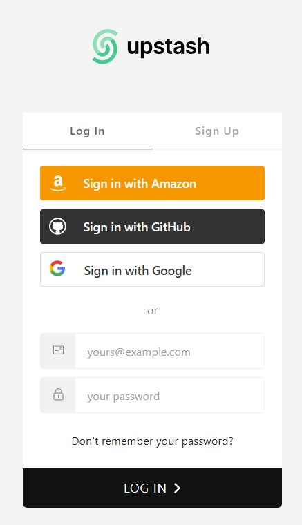
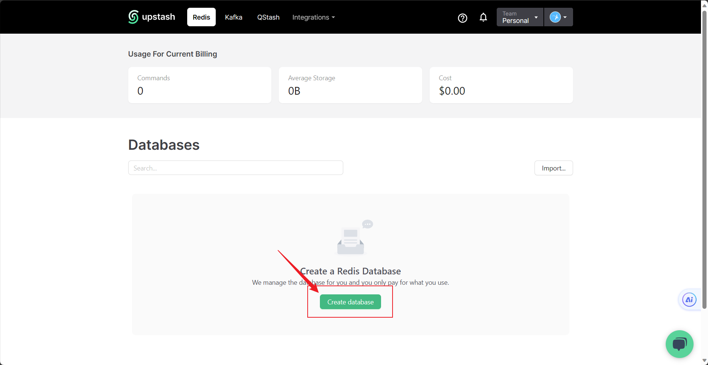
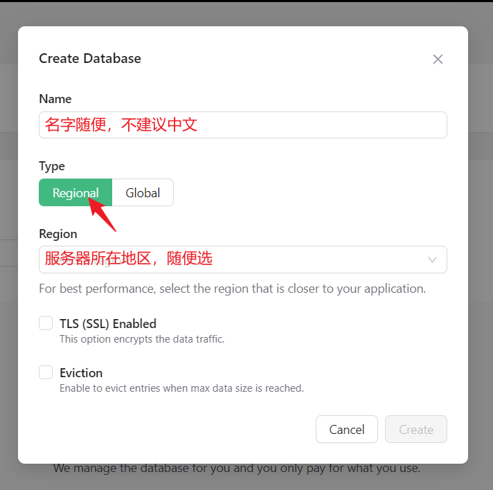
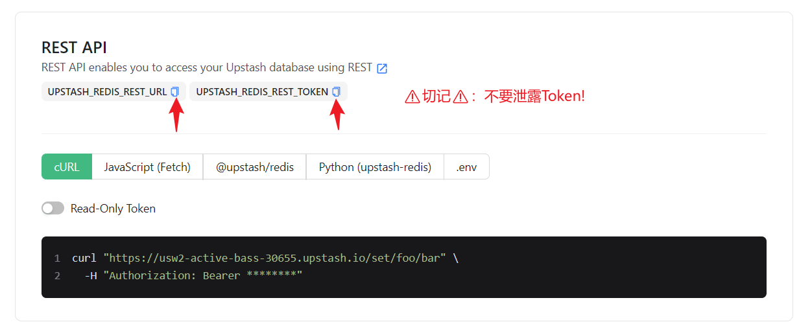
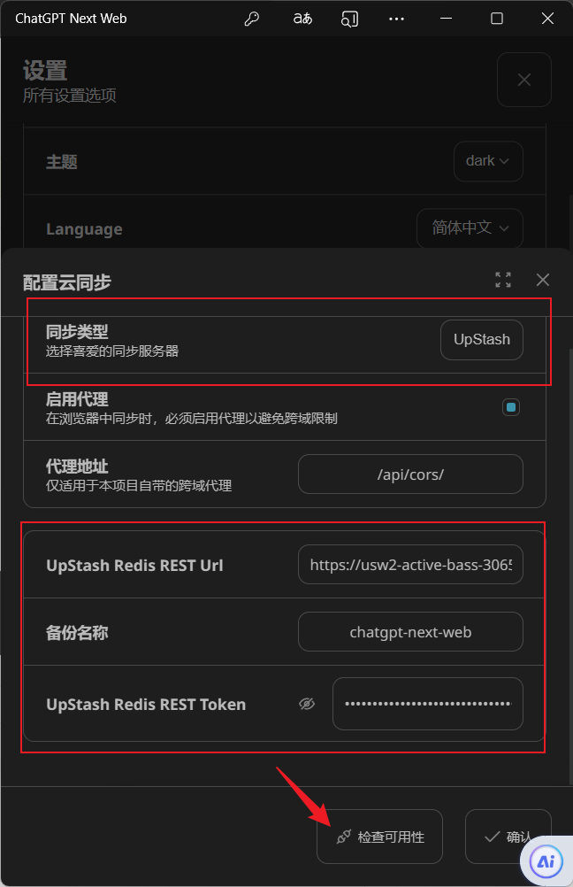
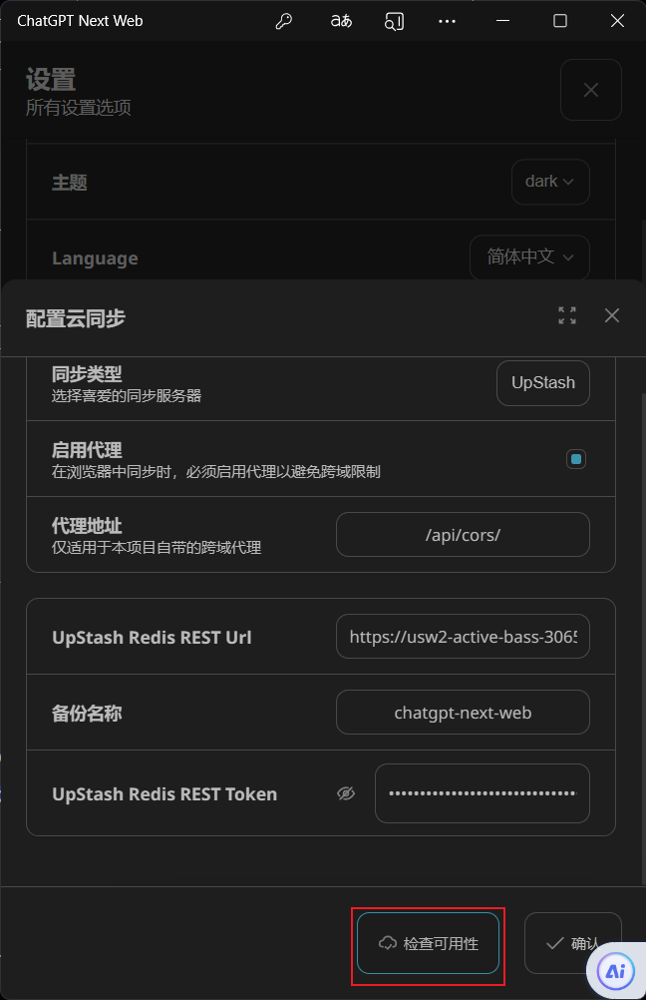
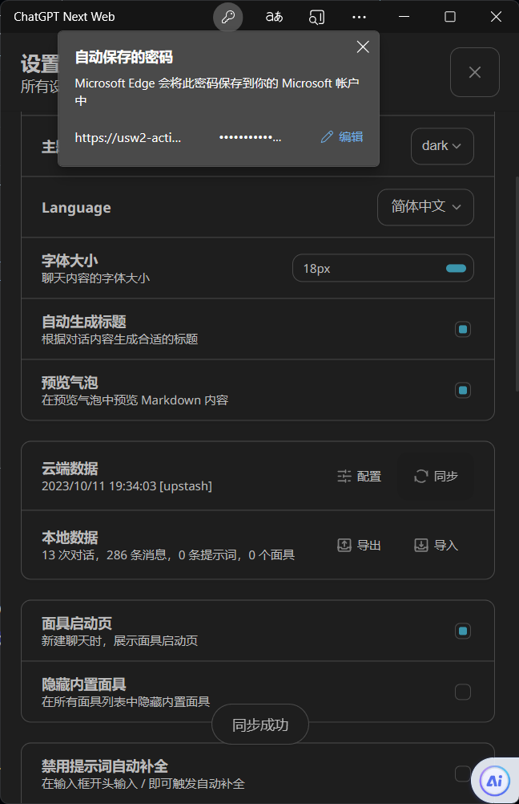

# 使用指南

本文说明 NextChat 的主要功能和设置。部署和环境变量见 [README](../README.md)，常见问题见 [FAQ](./faq.md)。

## 1. 访问授权

站点配置了访问码（服务端环境变量 `CODE`）时，第一次打开会进入授权页，输入访问码后才能对话。访问码保存在浏览器本地。

授权方式有两种：

- **访问码**：使用站点配置的上游和服务端 API Key。
- **自己的 API Key**：在"设置 → 自定义接口"中填写。站点没有关闭用户 Key（`HIDE_USER_API_KEY`）时，请求会使用你自己的 Key。

**自定义接口和插件需要访问码。** 在设置里填写自定义接口地址后，请求通过本站服务端代理转发，以避免浏览器跨域限制。为防止本站被当作任意中转使用：

- 站点开启访问码时，转发到自定义地址必须带有效访问码，只填 Key 会返回 401；
- 服务端自己的 API Key 永远不会发给自定义地址，所以自定义接口必须填写你在该接口上的 Key。

## 2. 模型

- **选择模型**：对话框上方的模型按钮只修改当前对话的模型；全局默认模型在"设置"中修改。
- **自定义模型**："设置 → 自定义模型"可以添加上游支持但列表里没有的模型，并为后端模型名设置展示名。展示名只用于界面，请求始终使用后端模型名。
- **服务端模型列表**：管理员可通过 `CUSTOM_MODELS`、`DEFAULT_MODEL`、`VISION_MODELS` 控制可选模型、默认模型和可识图模型，写法见 README。

## 3. 对话

### 3.1 发送图片

所选模型支持图片输入时，可以通过输入框旁的按钮、粘贴或拖拽附加图片：

- 支持 PNG、JPEG、WebP、HEIC/HEIF，单张不超过 20 MB；
- 每个模型能接收的图片数量有上限，超出时会提示；
- 发送前图片显示处理状态，处理失败的可以单独重试，或移除图片只发文字；
- 消息中的图片可以双击放大查看。

模型不支持图片时，附带图片的消息不会发送，并提示更换模型或移除图片。

### 3.2 对话框上方的按钮

将鼠标移到按钮上可以看到说明，主要有：

- **对话设置**：当前对话的设置，见 3.3；
- **主题**：在自动、深色、浅色之间切换；
- **快捷指令**：插入预设提示词，也可以在输入框输入 `/` 搜索；
- **面具**：进入面具页；
- **清除上下文**：插入一条分隔线，分隔线以上的消息不再发给模型；再点一次可以撤销；
- **模型**：修改当前对话的模型。

### 3.3 对话设置与全局设置

设置有两个入口：页面左下角是**全局设置**，对话框上方是**对话设置**。

新建的对话默认跟随全局设置。一旦手动修改过对话设置，该对话就不再跟随全局设置；在对话设置中勾选"使用全局设置"可以恢复跟随。

常用参数：

- **temperature / top_p / presence_penalty / frequency_penalty**：模型采样参数，含义见模型提供方文档。推理模型会忽略其中一部分。
- **附带历史消息数**：每次发送时携带最近多少条消息。
- **历史消息长度压缩阈值**与**历史摘要**：对话累计长度超过阈值后，自动把较早的消息总结成一段摘要，作为后续请求的背景信息。这是有损压缩：可以节省 token，但会丢失细节。翻译、信息提取这类一次性任务，建议关闭历史摘要，并把附带历史消息数设为 0。
- **max_tokens**：用于计算每次请求最多携带多少历史，不会作为输出长度上限发给模型。

### 3.4 一次请求包含哪些内容

1. 系统提示词（可在设置中关闭）；
2. 历史摘要（开启时）；
3. 面具或对话中的预设提示词；
4. 最近 N 条消息；推理模型在之前回复中给出的推理过程不会再发回模型；
5. 你当前的输入。

### 3.5 会话标题

对话达到一定长度后，会自动生成一个简短标题。也可以手动重命名对话，或使用“刷新标题”重新生成。

## 4. 面具与提示词

**面具**由三部分组成：一组预设提示词、模型设置和对话设置。用面具新建的对话会带上这些配置。内置面具在 `app/masks/` 中维护。自己配置好的面具可以在面具页下载为文件，也可以导入。

**提示词**可以在"设置 → 提示词"中管理。对话时在输入框输入 `/` 即可搜索并插入。

## 5. 插件与 MCP

- **插件**：在"插件"页管理，基于 OpenAPI 描述调用外部服务。内置的 DALL·E、arXiv 搜索、DuckDuckGo 搜索三个插件的描述文件随站点一起发布（`public/plugins/`）。插件请求经本站代理转发，因此同样需要访问码（见第 1 节）。
- **MCP**：服务端设置 `ENABLE_MCP=true` 后可用，在"MCP 市场"中添加和管理服务器。

## 6. 导出、分享与 Artifacts

- **导出对话**：在对话中选择导出，选好消息后可以复制或下载 Markdown 文本，也可以生成 PNG 图片。
- **Artifacts**：回复中的 HTML 代码可以在页面内预览，并保存为一个分享链接。保存需要已授权（访问码或自己的 Key）；打开分享链接不需要授权。服务端需要配置 `CLOUDFLARE_*` 环境变量（见 README）。

## 7. 数据存储与同步

对话、设置、面具都保存在浏览器本地（IndexedDB），不会上传到本站服务端。换浏览器或清除站点数据后，这些数据就不在了，请定期导出或同步。

"设置 → 同步"支持两种云端：

- **WebDAV**：默认只允许若干常见 WebDAV 服务；如需其他地址，由管理员在 `WHITE_WEBDAV_ENDPOINTS` 中加入。
- **Upstash Redis**：
  1. 在 [Upstash](https://upstash.com) 注册并创建 Redis 数据库：

     

     

     

  2. 在 REST API 区域复制 `UPSTASH_REDIS_REST_URL` 和 `UPSTASH_REDIS_REST_TOKEN`。Token 等同于数据库密码，不要泄露：

     

  3. 把这两项填入同步设置，点击"检查可用性"：

     

     

  4. 之后点击同步按钮，即可在多个设备之间同步数据：

     

## 8. 通过链接预填设置

管理员可以把访问码或接口配置放在链接里分发，打开后会先弹窗确认。站点设置了 `DISABLE_FAST_LINK` 时，这个功能关闭。

- **访问码**：`https://你的域名/#/?code=访问码`
- **接口与模型**：`https://你的域名/#/?settings=<JSON>`。JSON 需要 URL 编码，可用字段有：
  - `version`：固定为 `1`；
  - `provider`：例如 `OpenAI`；
  - `url`、`key`：接口地址和 Key；
  - `customModels`、`defaultModel`：自定义模型列表和默认模型。

  例如：

  ```json
  {"version":1,"provider":"OpenAI","url":"https://gateway.example.com","customModels":"+my-model"}
  ```

链接里的 Key 会出现在浏览器历史中，只在可信场合使用。
